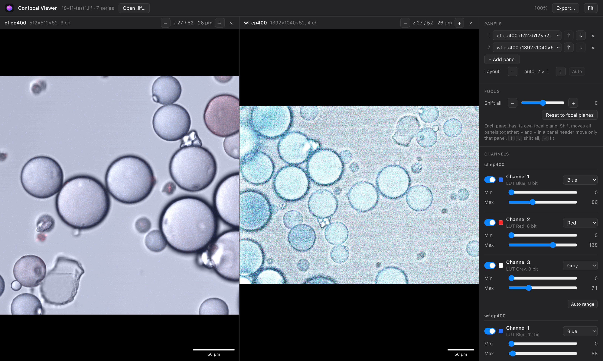

# Confocal Viewer

A single-file viewer for Leica `.lif` confocal and widefield stacks. Open `Confocal_Viewer.html` in a browser, then choose a `.lif` file or drop it on the window. The file is read in place with the browser File API; nothing is uploaded and no install, Python or server is needed.

## Features

- Reads `.lif` files directly in the browser, including multi-GB files (only the planes on screen are loaded)
- Any number of panels in any columns by rows layout; add, remove and reorder panels, drag the dividers to resize
- Synced zoom and pan across panels, each panel with its own focal plane, plus a shift that moves all planes together
- Per-channel colour, on/off and display range, shared by panels with the same channel layout so brightness stays comparable; auto range from the planes on screen
- Cursor readout of position in micrometres and raw channel values
- Scale bars from the file calibration; acquisition details (objective, zoom, pinhole, lasers, pixel size, z step) from the metadata
- Export as PNG, JPEG or SVG: as on screen or split channels (one column per channel plus merge), visible area or whole frame, native, 2x or 4x pixels, black or white background, optional titles, scale bar, z position and channel legend. SVG keeps labels and scale bars as editable text and shapes.

## Keyboard

| Key | Action |
|---|---|
| Up / Down | Shift all panels one slice |
| R or double-click | Fit view |
| E | Export |

## Limits

- 8, 12 and 16 bit images; time series and tile scans show the first time point or tile only
- Tested on files from a Leica confocal with LAS X (sequential 405/561 nm scans and camera widefield stacks); pixel values match `readlif`

## Presets

`PRESETS` near the top of the script can map a file name to friendly series labels, channel names, display ranges and starting focal planes. It is empty by default; the comment above it shows the format.
